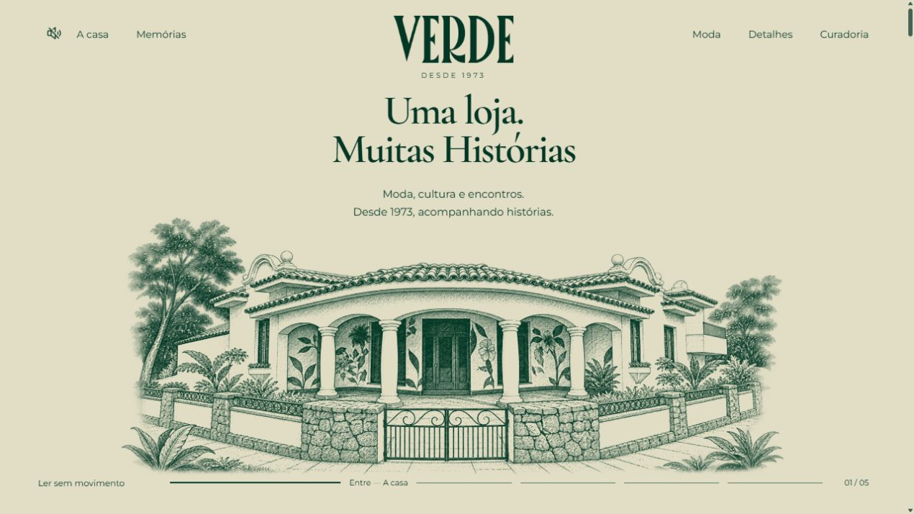
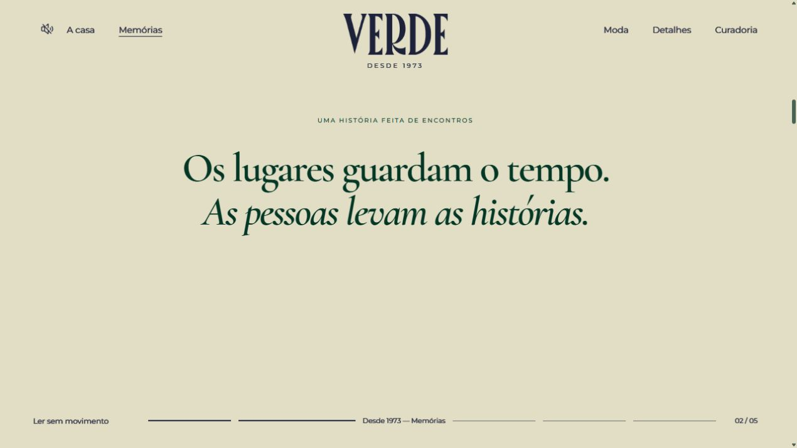
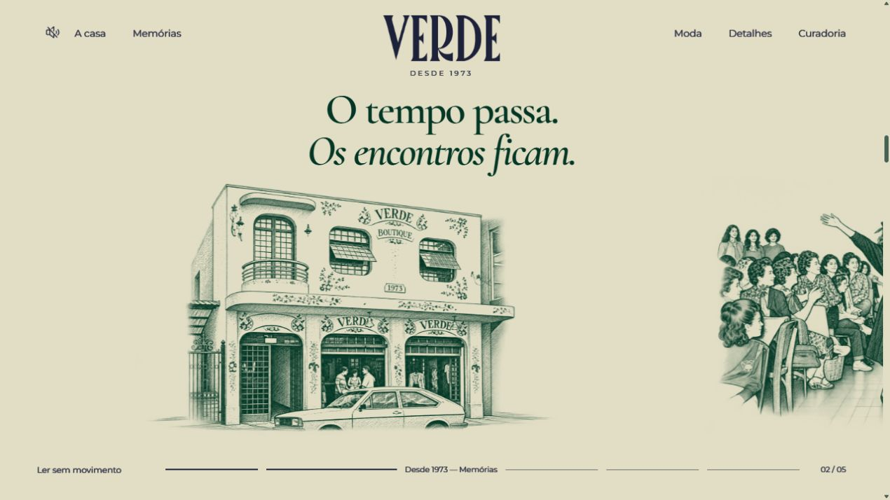
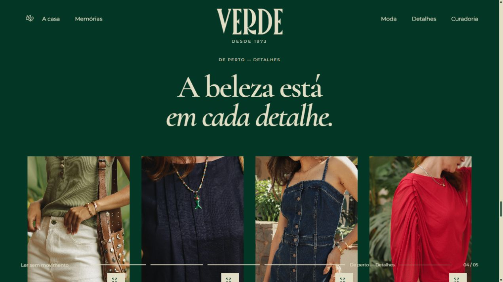

# Verde Boutique — revisão adversarial do site contra o brandbook

Data: 3 de novembro de 2026. Revisão independente da implementação em `C:/Projects/carloseduardogarcia/verde-boutique/Site`.

**Gate: aprovado com a ressalva da tipografia provisória dos títulos para a versão institucional apresentada.** Dois problemas concretos encontrados nesta revisão foram corrigidos durante o trabalho: cor não prevista no logo/interface e carregamento antecipado das quatro memórias. A identificação do monograma da Individual foi confirmada expressamente pelo usuário. Não encontrei outro bloqueador comprovado de identidade. Este gate não equivale a certificação completa de acessibilidade ou performance.

## Base e limites

- Fonte principal: `BrandBook VERDE.pdf` (acervo de marca local, preservado fora deste repositório), 55 páginas. Texto extraído do documento e páginas visuais de identidade, paleta, contraste, tipografia e aplicações inspecionadas. As referências abaixo usam **página física do PDF**, seguida da numeração impressa quando diferente.
- Código e ativos da pasta `Site`, incluindo os componentes de percurso, paleta, filmes, áudio, galeria e CSS.
- Capturas da rodada atual, registradas pelo agente principal e inspecionadas nesta revisão. As capturas anteriores à correção de cor são identificadas como tal; não servem como prova do estado final dessa cor.
- A revisão compara marca, conteúdo e telas. Não executei um segundo ensaio independente com leitor de tela, Safari/iPhone real, rede móvel ou métricas de campo. A verificação funcional de navegador/build pertence ao QA do agente principal.
- Instruções recentes do usuário prevalecem sobre o protótipo anterior: cru, quatro aproximações, ausência de controles locais e CTA, fotos sem legendas e preservação das últimas seções. Esses pontos não são classificados como defeitos por preferência do revisor.

## Achados, correções e ressalvas

### 1. P2 — Logo aparecia em cor alheia à paleta. Corrigido.

O cabeçalho convertia o logo para branco e aplicava `mix-blend-mode: difference` sobre o cru. O resultado era azul-marinho, matematicamente `#1D213A` sobre `#E2DEC5`, embora os arquivos de marca estivessem corretos. Era visível nas capturas `v6-final-01-hero.png` e `v6-23-hero-copy-assentada.png`.

**Regra documental:** PDF p.23, impressa 22, “Não use cores não previstas”; PDF p.26, impressa 25, mostra verde sobre cru e cru sobre verde como aplicações corretas. O usuário pediu transparência, não alteração da cor oficial.

**Correção inspecionada:** `src/journal.css:33`, `:43`, `:44` e `:132` preservam o fundo transparente e usam tinta verde/cru, sem o blend anterior. `src/IllustrationPalette.jsx:4` e `:5` recolorem somente o alfa do logo para os HEX oficiais. `Journal.jsx` detecta a superfície na posição do cabeçalho e do rodapé separadamente. A captura nítida `v6-final-13-hero-final.png` mostra verde no cru; `v6-final-07-detalhes-paleta-oficial.png` mostra cru no verde. Ambas foram inspecionadas, com os valores exatos de cor também conferidos no código.

### 2. P2 — Oito desenhos eram solicitados na entrada. Mitigado.

As ilustrações 09–16 somam **7.204.624 bytes**, aproximadamente 6,87 MiB. Hero e quatro memórias usavam `loading="eager"`, incluindo cenas muito abaixo da primeira tela. Em uma primeira visita móvel, isso criava concorrência desnecessária com a entrada e as fontes.

**Evidência técnica:** tamanho dos oito WebP em `public/assets`; estado original de `ArrivalJourney.jsx:20` e `MemoryJourney.jsx:43`. Não há medida de LCP que permita declarar reprovação de performance.

**Correção inspecionada:** `MemoryJourney.jsx:19`–`:21` agora usa `IntersectionObserver` com margem de antecipação de 150%; em `:53`, os `src` das quatro cenas só são atribuídos perto do percurso. Elas chegam juntas antes da passagem horizontal, preservando a continuidade. A abertura continua com quatro imagens antecipadas; medir em um celular real com rede limitada é o próximo refinamento, não um bloqueador demonstrado nesta revisão.

### 3. Ressalva de identidade — Tipografia dos títulos ainda é provisória.

PDF p.27, impressa 26, especifica **Beachwalk e Leona** para títulos/destaques e **Montserrat** para textos gerais. O site usa Montserrat corretamente, mas Cormorant Garamond nos títulos (`Journal.jsx:3`–`:6`; `journal.css:3`). Cormorant mantém o caráter editorial, porém não reproduz a personalidade estreita e retrô das fontes apresentadas no documento.

Isso está declarado em `DESIGN.md`: faltam os arquivos/licenças web. Não é falha oculta nem motivo para trocar a direção aprovada automaticamente. Para fechar uma versão estritamente conforme o sistema tipográfico, a marca deve fornecer as fontes web ou ratificar a substituição. Não recomendo adiar a revisão do restante por esse motivo.

### 4. Verificação de conteúdo — Monograma da Individual confirmado.

`content.js` apresenta o monograma fornecido como `marca-individual-transparente.png`. A associação inicial do arquivo `images.png` foi sinalizada por esta revisão porque o nome da parceira e a autoria do desenho exigiam confirmações distintas.

**Resolvido nesta sessão:** o usuário confirmou expressamente que o escudo com a letra I é da Individual. A atribuição deixa de ser ressalva. Manter o PNG fornecido com transparência e proporção preservada.

## Percurso e saúde por etapa

1. **Entrada ilustrada — boa após a correção de cor.** Quatro vistas distintas conduzem da rua ao interior. Copy menor e subtítulo em área calma. Não há CTA ou controles locais no componente. O logo usa a silhueta fornecida, sem compressão: `object-fit: contain` preserva o aspecto do arquivo de 1800×708. A tipografia editorial permanece sob a ressalva 3.
2. **Respiro e memórias — boa.** O cru continua entre os ambientes, e a frase faz a ponte narrativa. O percurso mostra fachada antiga, desfile, interior antigo e outdoor sem cartões opacos ou setas locais. A geração da fachada foi conferida com `img_2773.webp`: inclusive a inscrição 1973 existe na foto, não é uma data inventada pelo site.
3. **Acervo real e passagem ao presente — boa no material inspecionado.** Quatro fotos reais retomam as cenas ilustradas. A separação por título entre interpretação e registro real é clara. Não se atribuem datas exatas, nomes de pessoas ou autoria de roupas sem evidência.
4. **Moda e detalhes — boa, preservada.** Grades simétricas de seis e oito fotos, imagens distintas e sem legendas. A ausência dos parágrafos sob os títulos atende ao pedido recente. A fotografia colorida mantém a pluralidade visual da marca, mesmo com o percurso ilustrado limitado a verde/cru.
5. **Filmes, marcas e contato — boa.** Três vídeos verticais no desktop e um Giro de 20 s no mobile. Os manifestos registram zero trilhas de áudio nos MP4. `BrandFilms.jsx` oferece pausa e respeita redução de movimento; `AmbientAudio.jsx` depende de ativação do visitante. Contatos e identificação das parceiras correspondem às confirmações do usuário.

## Comparação com a identidade

**Paleta:** os preenchimentos vetoriais do PDF p.25, impressa 24, são `#033625`, `#E2DEC5`, `#C64B20`, `#56151D`, `#4F4718`, `#E5FCA4`, `#ABC8E8` e `#D8A7C0`. Vários rótulos HEX impressos não correspondem aos retângulos. O site está correto em adotar o verde e o cru reais; copiar literalmente os rótulos seria um erro. A decisão do usuário de usar duas cores nas ilustrações é compatível com selecionar um subconjunto da paleta.

**Tom e posicionamento:** PDF p.7, p.10–11 e p.13–14 privilegia pessoas, memória, gerações, cultura e proximidade acima da venda imediata. A casa, o acervo e os encontros sustentam esse posicionamento. “Desde 1973, acompanhando histórias” também aparece em aplicação no PDF p.42. A interface não incorpora preços, sacola ou falsa jornada comercial.

**Autenticidade visual:** os desenhos são interpretações do acervo, seguidos das fotografias reais. O duotone técnico é aplicado aos desenhos, não às fotos, aos filmes ou às marcas parceiras. Não identifiquei ativo de Brunello Cucinelli incorporado ao site. Essa referência foi usada para ritmo e espaço, não como identidade da Verde.

**Acesso e legibilidade:** o código mantém descrições de imagens, galeria com diálogo nativo, Escape, teclado e retorno de foco; modo de leitura e preferência de redução de movimento retiram os percursos presos à tela. As capturas de celular não mostram sobreposição do título com o telhado ou largura transbordando. Texto/menu fixos sobre fotografias ainda merecem verificação de contraste em cada passagem; não é possível garantir contraste mínimo de todos os pixels com capturas isoladas. Não atribuo conformidade WCAG completa a esta inspeção.

## Evidências da rodada

As imagens abaixo pertencem ao mesmo trabalho de revisão. Os arquivos 04/05 foram capturados antes da correção do azul no logo, mas documentam o ritmo e a retirada dos controles; para cor, usar 13/07.

## Fechamento do gate

As correções de cor e carregamento foram verificadas no código da pasta de entrega. A cor também foi conferida nas novas capturas. Não recomendo reformular as últimas seções ou acrescentar elementos comerciais para “corrigir” uma direção institucional aprovada.

Antes de considerar encerrada a entrega de produção, registrar o resultado final de build/test e da URL publicada no QA e ratificar as fontes dos títulos. O monograma da Individual está confirmado. A publicação e as permissões do GitHub/Vercel são verificadas pelo agente principal; este relatório não atesta que um deploy já ocorreu.
